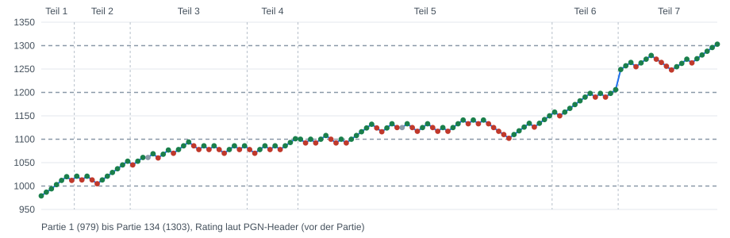

# Elo-Sprung vom 05.11.2026: von 979 auf 1303 an einem Tag (+324)

134 Bullet-Partien (60 s) an einem Tag. Das Bullet-Rating laut PGN-Header steigt von **979** (erste Partie des Tages) auf **1303** (letzte Partie): **+324**. Marken auf dem Weg: 1100 (Run 4/5), 1200 (Run 6), 1300 (Finale).

*Grün = Sieg, Rot = Niederlage, Grau = Remis. Gestrichelt: volle Hunderter.*

## Kernzahlen

| | |
|---|---|
| Partien | 134 (Bullet 60 s), in 7 Runs |
| Bilanz | **85 Siege, 2 Remis, 47 Niederlagen** (63 % Siege) |
| Rating (Header) | 979 → 1303, Höchstwert 1303, Tagestief 979 |
| Gegner im Schnitt | 1120 Elo (Run 1: 993, Run 2: 1026, Run 3: 1072, Run 4: 1077, Run 5: 1121, Run 6: 1169, Run 7: 1261) |
| Längste Siegesserie | 6 (endet nach Partie 6) |
| Längste Niederlagenserie | 5 |
| Stärkster Anstieg | +83 Rating in 10 Dateipartien (Partie 105 bis 115); überspannt eine Lücke zwischen zwei Runs, in der nicht exportierte Partien liegen, daher nur bedingt aussagekräftig |
| Siege nach Art | 26× Matt, 16× Aufgabe, 43× Zeit |
| Niederlagen nach Art | 21× Matt, 25× Zeit, 1× Aufgabe |
| Patzerquote (≥ 300 cp) | du 11.7 % (513 von 4370 Zügen), Gegner 11.3 % (493 von 4348) |

## Die 7 Runs des Tages

| Run | Partien | S–R–N | Rating Beginn → Ende (Header) | Höchstwert | Gegner Ø |
|---|---|---|---|---|---|
| Teil 1 | 7 | 6–0–1 | 979 → 1012 | 1020 | 993 |
| Teil 2 | 11 | 8–0–3 | 1021 → 1053 | 1053 | 1026 |
| Teil 3 | 23 | 13–1–9 | 1045 → 1086 | 1094 | 1072 |
| Teil 4 | 10 | 6–0–4 | 1078 → 1101 | 1101 | 1077 |
| Teil 5 | 50 | 28–1–21 | 1100 → 1150 | 1150 | 1121 |
| Teil 6 | 13 | 10–0–3 | 1158 → 1206 | 1206 | 1169 |
| Teil 7 | 20 | 14–0–6 | 1249 → 1303 | 1303 | 1261 |

Details pro Partie siehe [RUNS.md](RUNS.md).

## Wie der Sprung zustande kam (aus den Daten)

1. **Es war kein sauberer Durchmarsch.** 47 von 134 Partien gingen verloren, die längste Niederlagenserie war 5. Der Anstieg kam durch eine gute Gesamtquote (63 % Siege), nicht durch eine einzelne Serie.
2. **Die Gegner wurden stärker, das Rating stieg trotzdem:** Von 993 (Run 1) auf 1261 im letzten Run, die Siegquote blieb hoch. Gegen stärkere Gegner zählt ein Sieg mehr.
3. **Gewonnen wurde über Zeit, Aufgaben und Matt:** 26× Matt, 16× Aufgabe, 43× Zeit. Die Engine sah dich in vielen Siegen lange schlechter stehen; der Gegner hat Matt zugelassen, aufgegeben oder die Uhr verloren (siehe Fazit in RUNS.md).
4. **Fehlerquote:** Deine Patzerquote (11.7 %) liegt leicht über der deiner Gegner (11.3 %).
5. **Wiederkehrender Mattfehler:** Königszüge und Rochade (z. B. 27.Kh1, 8.O-O, 32.Kf1), siehe RUNS.md.

## Einschränkungen

- Das Rating ist der Wert im **Header vor der jeweiligen Partie**; das Rating nach der letzten Partie ist nicht bekannt. „+324“ misst also vom Stand vor der ersten bis vor der letzten Partie.
- Der Vergleich zum Vortag: Die letzte Partie vom 04.11. hatte laut Header 1003; zwischen den Tagen liegen Partien, die nicht in den Dateien sind (nach deiner Angabe Niederlagen). Gegenüber 1003 beträgt der Anstieg also +300, gegenüber dem Tagesbeginn (979) +324.
- **Lücken in den Dateien:** Zwischen Run 6 (letzte Partie Header 1206) und dem Finale (erste Partie 1249) fehlen Partien, ebenso zwischen einzelnen Runs; die Header-Werte springen dort, ohne dass die dazwischen liegenden Partien vorliegen. Der Gesamtanstieg ist daher aus den Header-Werten abgelesen, nicht aus lückenlos vorliegenden Partien.
- Die fünf Live-Blitzpartien vom 05.11. (5+0) sind hier nicht enthalten.
- Keine Uhrzeiten in den Partien: Lag, Zeitnot und Premoves lassen sich nicht belegen.
- Die Chess.com-Trophäe, die du erwähnt hast, steht nicht in den Daten und ist hier nicht belegt.
